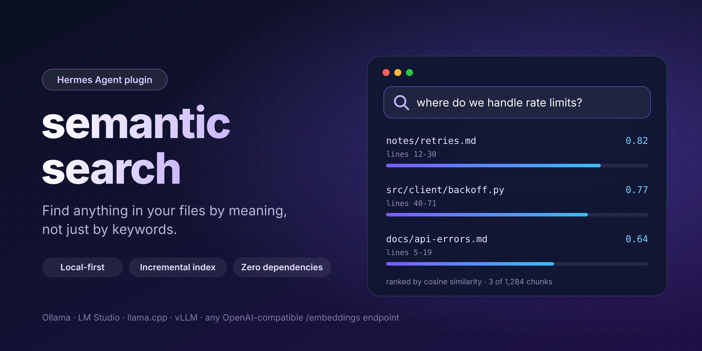
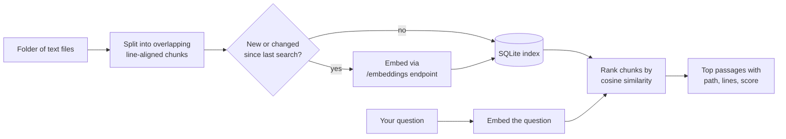

# semantic-search for Hermes Agent



[](https://github.com/Shizoqua/hermes-semantic-search/actions/workflows/tests.yml)
[](LICENSE)
[](https://www.python.org/)
[](https://github.com/NousResearch/hermes-agent)
[](#development)
[](https://github.com/Shizoqua/hermes-semantic-search/stargazers)

**Find passages in your local files by meaning, not just exact words.** Ask *"where do we handle
rate limits?"* and get back the relevant paragraphs from your notes, docs or code, even when they
never use the words "rate limit". Results come with file paths, line numbers and a similarity score.

The plugin adds one tool, `semantic_search`, to [Hermes Agent](https://github.com/NousResearch/hermes-agent).
Embeddings come from any OpenAI-compatible `/embeddings` endpoint. By default that is a local
[Ollama](https://ollama.com) server, so your files never leave your machine and searches cost nothing.

## Contents

- [Why](#why)
- [Features](#features)
- [Quick start](#quick-start)
- [Example](#example)
- [How it works](#how-it-works)
- [Supported embedding servers](#supported-embedding-servers)
- [Settings](#settings)
- [Troubleshooting](#troubleshooting)
- [Disclosure](#disclosure)
- [Roadmap](#roadmap)
- [Development](#development)
- [License](#license)

## Why

Keyword search only finds the words you remember. Notes say "back off and retry", code says
`except HTTPError as err: if err.code == 429`, and docs say "throttling". You remember none of
those phrasings. Semantic search compares *meaning*: the query and every passage are turned into
embedding vectors, and the passages pointing in the most similar direction come back first.

## Features

- **Search by meaning** across notes, docs and source code in any folder.
- **Local-first.** Works out of the box with Ollama, LM Studio, llama.cpp or vLLM on your own machine.
- **Fast repeat searches.** An incremental index re-embeds only files that changed since the last search.
- **Safe by default.** Skips hidden files, dependency folders, binaries and every path Hermes's own
  file tools refuse to read, such as `.env` files and credential stores.
- **Zero dependencies.** Python standard library only: nothing extra to install or audit.
- **Precise results.** Every hit names the file, the line range and a cosine similarity score.
- **Configurable** from the Hermes Desktop settings page or `hermes plugins config semantic-search`.

## Quick start

1. **Install the plugin:**

   ```bash
   hermes plugins install semantic-search
   hermes plugins enable semantic-search
   ```

2. **Start a local embeddings server** (Ollama shown; see [other servers](#supported-embedding-servers)):

   ```bash
   ollama pull nomic-embed-text
   ollama serve            # if it is not already running
   ```

3. **Ask Hermes:**

   > Search my notes in ~/notes for how I set up backups.

The first search of a folder builds its index. Later searches only re-read files that changed.

## Example

A search across a small project. The model receives this from the tool:

```json
{
  "query": "how does the client handle rate limiting and retries",
  "root": "/home/me/project",
  "model": "nomic-embed-text",
  "results": [
    {
      "path": "notes/retries.md",
      "lines": "1-3",
      "score": 0.5948,
      "text": "Retry policy\n\nWhen the API answers 429 the client waits with exponential backoff and jitter, then retries up to five times."
    },
    {
      "path": "notes/pasta.md",
      "lines": "1-3",
      "score": 0.1849,
      "text": "Dinner\n\nBoil pasta in salted water, add garlic and olive oil."
    }
  ],
  "index": {"indexed_files": 0, "reused_files": 2, "removed_files": 0, "chunks": 2}
}
```

The relevant note scores far above the unrelated one, and `"indexed_files": 0` shows that the
second search reused the index instead of embedding the folder again.

## How it works



1. **Chunking.** Text files are split into chunks of whole lines (1,200 characters by default).
   Neighbouring chunks share two lines, so a passage that straddles a boundary is still found whole.
2. **Embedding.** Chunks are sent to the embeddings endpoint in batches of 32 and stored as float32
   vectors with their precomputed norms.
3. **Incremental index.** The index lives in SQLite in the plugin's own data folder
   (`<hermes home>/plugin-data/semantic-search/index.db`), keyed by folder and embedding model. Only
   new or changed files (by modification time and size) are re-embedded, and deleted files are dropped.
4. **Ranking.** The question is embedded the same way and chunks are ranked by cosine similarity:
   `score = (q · c) / (‖q‖ ‖c‖)`.

Indexes for different embedding models are kept apart, so switching models never mixes vectors.

**What gets indexed:** common text, documentation, code and config extensions (`.md`, `.txt`, `.py`,
`.ts`, `.go`, `.rs`, `.json`, `.yaml`, ...). **Skipped:** hidden files and folders, dependency and
build folders (`node_modules`, `venv`, `dist`, `build`, ...), symlinks, binary files, files over the
size limit, and every path Hermes's file tools refuse to read.

## Supported embedding servers

Any server that implements the OpenAI `POST /embeddings` API works. Set `base_url` to its `/v1` root.

| Server | `base_url` | Example `embedding_model` |
|---|---|---|
| [Ollama](https://ollama.com) (default) | `http://localhost:11434/v1` | `nomic-embed-text`, `mxbai-embed-large` |
| [LM Studio](https://lmstudio.ai) | `http://localhost:1234/v1` | the embedding model you loaded |
| [llama.cpp server](https://github.com/ggml-org/llama.cpp) (`--embeddings`) | `http://localhost:8080/v1` | the loaded model's name |
| [vLLM](https://github.com/vllm-project/vllm) | `http://localhost:8000/v1` | e.g. `BAAI/bge-m3` |
| Hosted OpenAI-compatible APIs | the provider's `/v1` URL | the provider's embedding model (set `api_key`) |

## Settings

Edit them in the Desktop app (**Settings → Plugins → semantic-search**) or with
`hermes plugins config semantic-search`.

| Setting | Default | Meaning |
|---|---|---|
| `base_url` | `http://localhost:11434/v1` | OpenAI-compatible base URL; the plugin calls `<base_url>/embeddings` |
| `embedding_model` | `nomic-embed-text` | Model name the endpoint serves |
| `api_key` | not set | Only for hosted endpoints; stored by Hermes as `SEMANTIC_SEARCH_API_KEY` |
| `top_k` | `5` | Passages returned per search (the model may ask for 1 to 20) |
| `chunk_chars` | `1200` | Chunk size in characters; applies to files indexed afterwards |
| `max_files` | `2000` | Files indexed per folder |
| `max_file_kb` | `1000` | Larger files are skipped |

## Troubleshooting

| Message | Fix |
|---|---|
| `cannot reach the embeddings server at http://localhost:11434/v1` | Start Ollama (`ollama serve`) or point `base_url` at your server. |
| `answered HTTP 404 ... model not found` | Pull the model (`ollama pull nomic-embed-text`) or set `embedding_model` to one the server has. |
| `answered HTTP 401` | A hosted endpoint needs `api_key`. |
| No results for files you expected | Check the file's extension, size (`max_file_kb`) and that it is not hidden or in a skipped folder. |
| The first search is slow | Expected for a large folder: every file is embedded once. Later searches only embed changes. |

## Disclosure

- **Network:** file contents (chunks) and search queries are sent to the embeddings endpoint you
  configure. The default is a server on your own machine. If you point `base_url` at a hosted API,
  that service receives the text of the files you search.
- **Files read:** text files under the folder the model asks to search, minus the skipped paths
  listed above. The plugin never writes to that folder.
- **Files written:** the index database in the plugin's own data folder only.
- **Credentials:** the optional API key is read through Hermes's secret store and sent only to the
  configured endpoint. It is dropped if the endpoint redirects to another origin.
- No telemetry, no background processes, no shell commands, no self-updating.

## Roadmap

- Hybrid ranking: combine keyword (BM25) and vector scores.
- Result diversity (MMR) so near-duplicate chunks do not crowd the top results.
- A `/semantic-search reindex` command and index statistics.
- Tested on macOS and Windows in CI.

Ideas and bug reports are welcome in [Issues](https://github.com/Shizoqua/hermes-semantic-search/issues).

## Development

The search engine (`engine.py`) and the HTTP client (`embeddings.py`) use only the Python standard
library and do not import Hermes, so the tests run without a Hermes install or network access:

```bash
python -m pip install "pytest>=8,<9"
python -m pytest tests
```

`__init__.py` holds the Hermes wiring (tool registration, settings, file-safety checks, storage).
Before a release, check the plugin the way the Hermes catalog does:

```bash
hermes plugins validate . --install-deps
hermes plugins doctor . --ci
```

See [CONTRIBUTING.md](CONTRIBUTING.md) for the workflow and [CHANGELOG.md](CHANGELOG.md) for releases.

## License

MIT, see [LICENSE](LICENSE). Made by [Lanre Shittu](https://github.com/Shizoqua).
