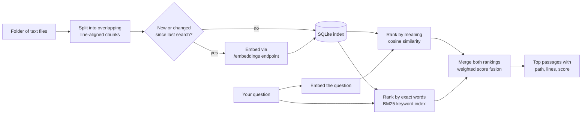

<div align="center">


# hermes-scout

**Search your local files by meaning, not just keywords.**<br>
A [Hermes Agent](https://github.com/NousResearch/hermes-agent) plugin and a standalone command line tool.


[](https://pypi.org/project/hermes-scout/)
[](https://pepy.tech/project/hermes-scout)
[](https://github.com/Shizoqua/hermes-scout/actions/workflows/tests.yml)
[](https://shizoqua.github.io/hermes-scout/)
<br>
[](https://www.python.org/)
[](https://github.com/NousResearch/hermes-agent)
[](#development)
[](LICENSE)
[](https://scorecard.dev/viewer/?uri=github.com/Shizoqua/hermes-scout)

[**Documentation**](https://shizoqua.github.io/hermes-scout/) ·
[**Getting started**](https://shizoqua.github.io/hermes-scout/getting-started/) ·
[**Changelog**](CHANGELOG.md) ·
[**Report a bug**](https://github.com/Shizoqua/hermes-scout/issues/new/choose)

</div>

---

Ask *"where do we handle rate limits?"* and get back the relevant paragraphs from your notes, docs
or code, even when they never use the words "rate limit". Results come with file paths, line
numbers and a similarity score.

hermes-scout works two ways:

- **As a Hermes Agent plugin**, adding two tools: `scout_search` (find passages) and
  `scout_similar` (find files related to a file or passage).
- **As a standalone command**, `hermes-scout search "..." ~/notes`, for anyone with Python.

Embeddings come from any OpenAI-compatible `/embeddings` endpoint. By default that is a local
[Ollama](https://ollama.com) server, so your files never leave your machine and searches cost nothing.


## Contents

- [Why](#why)
- [Features](#features)
- [Quick start](#quick-start)
- [Command line](#command-line)
- [In Hermes: the /scout command](#in-hermes-the-scout-command)
- [Example](#example)
- [How it works](#how-it-works)
- [Benchmark](#benchmark)
- [Supported embedding servers](#supported-embedding-servers)
- [Settings](#settings)
- [Troubleshooting](#troubleshooting)
- [Disclosure](#disclosure)
- [Roadmap](#roadmap)
- [Development](#development)
- [Contributing](#contributing)
- [Star History](#star-history)
- [License](#license)

## Why

Keyword search only finds the words you remember. Notes say "back off and retry", code says
`except HTTPError as err: if err.code == 429`, and docs say "throttling". You remember none of
those phrasings. Semantic search compares *meaning*: the query and every passage are turned into
embedding vectors, and the passages pointing in the most similar direction come back first.

## Features

- **Hybrid search.** Ranks by meaning *and* by exact words together, so it finds "how we handle
  throttling" and `ERR_4291` alike. Switch to meaning-only or keyword-only when you want.
- **Find similar.** Point at a file or a passage and get the most related files: related notes,
  overlapping docs, code that does something similar.
- **Local-first.** Works out of the box with Ollama, LM Studio, llama.cpp or vLLM on your own machine.
- **Fast repeat searches.** An incremental index re-embeds only files that changed since the last search.
- **Safe by default.** Skips hidden files, dependency folders, binaries and every path Hermes's own
  file tools refuse to read, such as `.env` files and credential stores.
- **Zero dependencies.** Python standard library only: nothing extra to install or audit.
- **Respects `.gitignore`.** Files your project ignores (build output, logs, generated code) stay
  out of the index, at every folder level, with `!` re-includes, just like git.
- **Filters.** Narrow a search to `*.md`, `docs/` or `src/**/*.py` without re-indexing.
- **Precise results.** Every hit names the file, the line range and a cosine similarity score.
- **Cross-platform.** Tested on Linux, macOS and Windows with Python 3.11 to 3.14.
- **Two ways to use it:** as a Hermes tool or as a `hermes-scout` command in any terminal.
- **Configurable** from the Hermes Desktop settings page or `hermes plugins config hermes-scout`.

## Quick start

1. **Start a local embeddings server** (Ollama shown; see [other servers](#supported-embedding-servers)):

   ```bash
   ollama pull nomic-embed-text
   ollama serve            # if it is not already running
   ```

2. **Install hermes-scout** in Hermes:

   ```bash
   hermes plugins install hermes-scout
   hermes plugins enable hermes-scout
   ```

   or as a command line tool:

   ```bash
   pipx install hermes-scout      # or: pip install hermes-scout
   ```

3. **Check the setup** before your first search, using the option that matches your install:

   - **Hermes plugin:** run `/scout doctor` inside Hermes.
   - **Standalone CLI:** run `hermes-scout doctor` in a terminal.

   This checks the embeddings server, model and keyword search. If something fails, see
   [Troubleshooting](#troubleshooting).

4. **Search.** Ask Hermes:

   > Search my notes in ~/notes for how I set up backups.

   or run:

   ```bash
   hermes-scout search "how I set up backups" ~/notes
   ```

The first search of a folder builds its index. Later searches only re-read files that changed.

For example, to search Markdown notes only or look up an exact error code from the terminal:

```bash
hermes-scout search "meeting notes about backups" ~/notes -g "*.md"
hermes-scout search "ERR_4291" ~/project --ranking keyword
```

Use `--ranking keyword` when you already know the exact term or identifier you're looking for.

## Command line

```console
$ hermes-scout search "how does the client handle rate limiting" ~/project
0.59  notes/retries.md:1-3
      Retry policy
0.18  notes/pasta.md:1-3
      Dinner
```

| Command | What it does |
|---|---|
| `hermes-scout search QUERY [PATH]` | Search a folder (default: the current one). `-k 10` for more results, `-g "*.md"` to filter, `--ranking keyword` for exact words only, `--json` for scripts. |
| `hermes-scout similar FILE --in FOLDER` | Files most related to `FILE` (or `--text "..."`); `--lines 10-40` for part of a file. |
| `hermes-scout index [PATH]` | Build or refresh the index ahead of time. |
| `hermes-scout doctor` | Check the embeddings server, the model and keyword search, and say how to fix what fails. |
| `hermes-scout status` | List the indexed folders with file and chunk counts. |
| `hermes-scout clear PATH` | Forget a folder's index (`--all` for every folder). |
| `hermes-scout --version` | Print the version. |

Point it at another server with `--base-url` and `--model`, or the `SCOUT_BASE_URL` and
`SCOUT_MODEL` environment variables. Hosted endpoints read their key from `SCOUT_API_KEY`. The
index lives in your user cache folder (`~/.cache/hermes-scout/index.db` on Linux). Full reference:
[Command line docs](https://shizoqua.github.io/hermes-scout/cli/).

## In Hermes: the `/scout` command

| Command | What it does |
|---|---|
| `/scout doctor` | Checks the embeddings server, the model and keyword search in one go, with the fix for anything that fails. |
| `/scout status` | Lists the indexed folders with file and chunk counts. |
| `/scout index [folder]` | Builds or refreshes a folder's index now, so the first search is instant. |
| `/scout clear <folder>`, `/scout clear all` | Forgets a folder's index, or every index. |

The plugin also ships a `scout` skill that tells the agent when searching by meaning beats a plain
text search, and how to narrow and cite results.

## Example

A search across a small project. The model receives this from the tool:

```json
{
  "query": "how does the client handle rate limiting and retries",
  "root": "/home/me/project",
  "model": "nomic-embed-text",
  "results": [
    {
      "path": "notes/retries.md",
      "lines": "1-3",
      "score": 0.5948,
      "text": "Retry policy\n\nWhen the API answers 429 the client waits with exponential backoff and jitter, then retries up to five times."
    },
    {
      "path": "notes/pasta.md",
      "lines": "1-3",
      "score": 0.1849,
      "text": "Dinner\n\nBoil pasta in salted water, add garlic and olive oil."
    }
  ],
  "index": {"indexed_files": 0, "reused_files": 2, "removed_files": 0, "chunks": 2}
}
```

The relevant note scores far above the unrelated one, and `"indexed_files": 0` shows that the
second search reused the index instead of embedding the folder again.

## How it works



1. **Chunking.** Text files are split into chunks of whole lines (1,200 characters by default).
   Neighbouring chunks share up to two lines, so a passage that straddles a boundary is still found
   whole. A line longer than the chunk size is split into pieces, so nothing is cut off.
2. **Embedding.** Chunks are sent to the embeddings endpoint in batches of 32 and stored as float32
   vectors with their precomputed norms.
3. **Incremental index.** The index lives in SQLite in the plugin's own data folder
   (`<hermes home>/plugin-data/hermes-scout/index.db`), keyed by folder and embedding model. Only
   new or changed files (by modification time and size) are re-embedded, and deleted files are dropped.
4. **Ranking.** The question is embedded the same way and every chunk gets a cosine similarity,
   `score = (q · c) / (‖q‖ ‖c‖)`. The question's words are also looked up in a keyword index
   (SQLite full-text search with BM25 and word stemming, built alongside the vectors), leaving out
   filler words such as "how" or "the" that appear everywhere. The default `hybrid` ranking picks by
   query: questions in words are ranked by meaning, which [the benchmark](#benchmark) measured as
   the most accurate for them; a query made only of code-like names (`ERR_4291`, `pg_dump`,
   `getUserById`), which embedding models often blur, merges both rankings by score with keywords
   at 75% and meaning at 25%, so the exact name comes first. The `ranking` setting (or the tool's `ranking` argument, or `--ranking`) switches to meaning only (`semantic`) or
   words only (`keyword`). If Python's SQLite lacks full-text search (FTS5), search falls back to
   meaning only and says so in a one-line note.
5. **Find similar.** `scout_similar` averages the vectors of a file (or a line range of it) and
   returns the other files whose best passage is closest, one result per file.

Indexes for different embedding models are kept apart, so switching models never mixes vectors.

**What gets indexed:** common text, documentation, code and config extensions (`.md`, `.txt`, `.py`,
`.ts`, `.go`, `.rs`, `.json`, `.yaml`, ...). **Skipped:** hidden files and folders, dependency and
build folders (`node_modules`, `venv`, `dist`, `build`, ...), anything a `.gitignore` file ignores,
symlinks, binary files, files over the size limit, and every path Hermes's file tools refuse to read.

## Benchmark

On a synthetic project of 23 files with 30 questions whose answer is known, using `nomic-embed-text`
on Ollama ([details and method](https://shizoqua.github.io/hermes-scout/benchmark/)):

| Ranking | Right file first | Right file in top 5 |
|---|---|---|
| Default (`hybrid`) | 93% | 100% |
| Meaning only (`semantic`) | 93% | 100% |
| Keywords only (`keyword`) | 63% | 83% |

Exact names and error codes are found first in every mode. Questions worded differently from the
answer are where meaning-based search pays off: 89% first-place hits against 39% for keywords alone.

## Supported embedding servers

Any server that implements the OpenAI `POST /embeddings` API works. Set `base_url` to its `/v1` root.

| Server | `base_url` | Example `embedding_model` |
|---|---|---|
| [Ollama](https://ollama.com) (default) | `http://localhost:11434/v1` | `nomic-embed-text`, `mxbai-embed-large` |
| [LM Studio](https://lmstudio.ai) | `http://localhost:1234/v1` | the embedding model you loaded |
| [llama.cpp server](https://github.com/ggml-org/llama.cpp) (`--embeddings`) | `http://localhost:8080/v1` | the loaded model's name |
| [vLLM](https://github.com/vllm-project/vllm) | `http://localhost:8000/v1` | e.g. `BAAI/bge-m3` |
| Hosted OpenAI-compatible APIs | the provider's `/v1` URL | the provider's embedding model (set `api_key`) |

## Settings

In Hermes, edit them in the Desktop app (**Settings → Plugins → hermes-scout**) or with
`hermes plugins config hermes-scout`. The command line takes the same settings as flags
(`--base-url`, `--model`, `--chunk-chars`, `--max-files`, `--max-file-kb`, `--no-gitignore`, `-k`).

| Setting | Default | Meaning |
|---|---|---|
| `base_url` | `http://localhost:11434/v1` | OpenAI-compatible base URL; the plugin calls `<base_url>/embeddings` |
| `embedding_model` | `nomic-embed-text` | Model name the endpoint serves |
| `api_key` | not set | Only for hosted endpoints; stored by Hermes as `SCOUT_API_KEY` |
| `top_k` | `5` | Passages returned per search (the model may ask for 1 to 20) |
| `chunk_chars` | `1200` | Chunk size in characters; applies to files indexed afterwards |
| `max_files` | `2000` | Files indexed per folder |
| `max_file_kb` | `1000` | Larger files are skipped |
| `respect_gitignore` | `true` | Skip files and folders that `.gitignore` files in the searched folder ignore |
| `ranking` | `hybrid` | `hybrid`: meaning for questions, exact words first for code names like `ERR_4291`; `semantic`: meaning only; `keyword`: exact words only |

## Troubleshooting

| Message | Fix |
|---|---|
| Not sure what is wrong | Run `/scout doctor` in Hermes or `hermes-scout doctor` in a terminal. It checks everything and names the fix. |
| `cannot reach the embeddings server at http://localhost:11434/v1` | Start Ollama (`ollama serve`) or point `base_url` at your server. |
| `answered HTTP 404 ... model not found` | Pull the model (`ollama pull nomic-embed-text`) or set `embedding_model` to one the server has. |
| `answered HTTP 401` | A hosted endpoint needs `api_key`. |
| No results for files you expected | Check the file's extension, size (`max_file_kb`), that it is not hidden or in a skipped folder, and that no `.gitignore` ignores it. |
| The first search is slow | Expected for a large folder: every file is embedded once. Later searches only embed changes. |

## Disclosure

- **Network:** file contents (chunks) and search queries are sent to the embeddings endpoint you
  configure. The default is a server on your own machine. If you point `base_url` at a hosted API,
  that service receives the text of the files you search.
- **Files read:** text files under the folder the model asks to search, minus the skipped paths
  listed above. The plugin never writes to that folder.
- **Files written:** the index database in the plugin's own data folder only. `/scout clear`
  deletes rows from it; nothing else is ever deleted.
- **Health check:** `/scout doctor` sends one fixed test sentence to the embeddings endpoint.
- **Credentials:** the optional API key is read through Hermes's secret store and sent only to the
  configured endpoint. It is dropped if the endpoint redirects to another origin.
- No telemetry, no background processes, no shell commands, no self-updating.

## Roadmap

- Result diversity (MMR) so near-duplicate chunks do not crowd the top results.
- An index statistics command and a way to clear old indexes.

Ideas and bug reports are welcome in [Issues](https://github.com/Shizoqua/hermes-scout/issues).

## Development

The search engine (`hermes_scout/engine.py`) and the HTTP client (`hermes_scout/embeddings.py`) use
only the Python standard library and do not import Hermes, so the tests run without a Hermes install
or network access:

```bash
python -m pip install "pytest>=8,<9" "pytest-cov>=6,<8" "ruff==0.15.10" "mypy==1.18.2"
python -m pytest --cov=hermes_scout     # 111 tests, no network
ruff check . && ruff format --check .
mypy                                    # strict type check
```

| Path | Contents |
|---|---|
| `hermes_scout/__init__.py` | Hermes wiring: tool registration, settings, file-safety checks, storage |
| `hermes_scout/plugin.yaml` | Plugin manifest read by Hermes |
| `hermes_scout/engine.py` | Chunking, file walking, the SQLite index and ranking |
| `hermes_scout/patterns.py` | `.gitignore` rules and search filters |
| `hermes_scout/embeddings.py` | OpenAI-compatible embeddings client |
| `hermes_scout/cli.py` | The `hermes-scout` command |
| `docs/` | The documentation site (MkDocs Material) |

Before a release, check the plugin the way the Hermes catalog does:

```bash
hermes plugins validate hermes_scout --install-deps
hermes plugins doctor hermes_scout --ci
```

Every push runs lint, a strict type check, the tests on Linux, macOS and Windows with Python 3.11
to 3.14 and a 90% coverage floor, CodeQL security analysis, an OpenSSF Scorecard rating and a strict
docs build. Publishing a GitHub release uploads the package to PyPI.

## Contributing

Bug reports, ideas and pull requests are welcome. Start with [CONTRIBUTING.md](CONTRIBUTING.md);
the [Code of Conduct](CODE_OF_CONDUCT.md) applies everywhere in this project. Report security
problems privately as described in [SECURITY.md](SECURITY.md). Release notes live in
[CHANGELOG.md](CHANGELOG.md).

If hermes-scout is useful to you, a star helps other people find it.

## Star History

<a href="https://star-history.com/#Shizoqua/hermes-scout&Timeline">
  <picture>
    <source media="(prefers-color-scheme: dark)" srcset="https://api.star-history.com/svg?repos=Shizoqua/hermes-scout&type=Timeline&theme=dark" />
    <source media="(prefers-color-scheme: light)" srcset="https://api.star-history.com/svg?repos=Shizoqua/hermes-scout&type=Timeline" />
    
  </picture>
</a>

## License

MIT, see [LICENSE](LICENSE). Made by [Lanre Shittu](https://github.com/Shizoqua). To cite this project, use
the "Cite this repository" button on GitHub ([CITATION.cff](CITATION.cff)).
