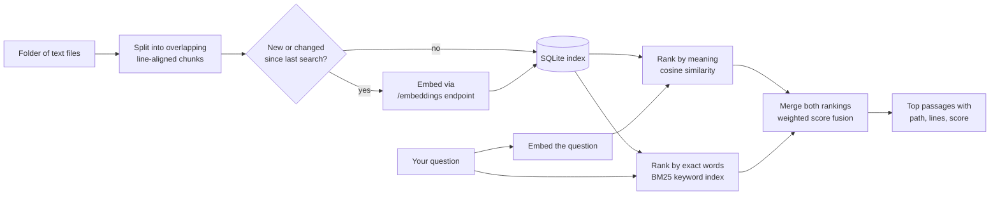

# How it works

1. **Chunking.** Text files are split into chunks of whole lines (1,200 characters by default).
   Neighbouring chunks share up to two lines, so a passage that straddles a boundary is still found
   whole. A line longer than the chunk size is split into pieces, so nothing is cut off.
2. **Embedding.** Chunks are sent in batches of 32 and stored as float32 vectors with precomputed norms.
3. **Incremental index.** The SQLite index is keyed by folder and embedding model. Only new or changed
   files (by modification time and size) are re-embedded, and deleted files are dropped.
4. **Ranking.** The question is embedded the same way and every chunk gets a cosine similarity,
   `score = (q · c) / (‖q‖ ‖c‖)`. The question's words are also looked up in a keyword index
   (SQLite full-text search with BM25 and word stemming, built alongside the vectors), leaving out
   filler words such as "how" or "the" that appear everywhere. The default `hybrid` ranking picks by
   query: questions in words are ranked by meaning, which [the benchmark](benchmark.md) measured as
   the most accurate for them; a query made only of code-like names (`ERR_4291`, `pg_dump`,
   `getUserById`), which embedding models often blur, merges both rankings by score with keywords
   at 75% and meaning at 25%, so the exact name comes first. The `ranking` setting (or the tool's `ranking` argument, or `--ranking`) switches to meaning only (`semantic`) or
   words only (`keyword`). If Python's SQLite lacks full-text search (FTS5), search falls back to
   meaning only and says so in a one-line note.
5. **Find similar.** `scout_similar` averages the vectors of a file (or a line range of it) and
   returns the other files whose best passage is closest, one result per file.

Indexes for different embedding models are kept apart, so switching models never mixes vectors.

## What gets indexed

Common text, documentation, code and config extensions (`.md`, `.txt`, `.py`, `.ts`, `.go`, `.rs`,
`.json`, `.yaml`, ...). Skipped: hidden files and folders, dependency and build folders
(`node_modules`, `venv`, `dist`, `build`, ...), symlinks, binary files and files over the size limit.
Inside Hermes, paths Hermes's file tools refuse to read are skipped as well.

## PDF and Word files

PDF and Word (`.docx`) files up to 20 MB are indexed by their text, extracted on your machine with
Python's standard library. Each PDF page starts with a `[page N]` line, so a result's passage shows
which page it came from. Turn this off with the `read_documents` setting or `--no-documents`.

What works and what does not:

- Text-based PDFs, the usual kind exported from Word, LibreOffice, Google Docs or LaTeX, including
  accented and non-Latin text when the PDF maps its fonts to Unicode.
- Word `.docx` files: body text, tables, footnotes and endnotes. Older `.doc` files are not read.
- Scanned PDFs (pictures of pages) and encrypted PDFs contain no extractable text and are skipped,
  as is any file that cannot be read. Nothing is guessed: such files simply do not appear in results.

## `.gitignore`

Files and folders that a `.gitignore` file ignores are left out of the index, the way git would:
`.gitignore` files in subfolders apply below them, a pattern without a `/` matches at any depth,
`/pattern` is anchored to its folder, `folder/` matches folders only, `**` crosses folders and
`!pattern` re-includes something an earlier rule ignored. Turn this off with the
`respect_gitignore` setting or the `--no-gitignore` flag.

## Filters

A search can be limited to some files without re-indexing: `*.md` (any Markdown file), `docs/`
(everything in a folder) or `src/**/*.py` (Python files at any depth under `src`). Separate several
patterns with commas in Hermes, or repeat `-g` on the command line.
