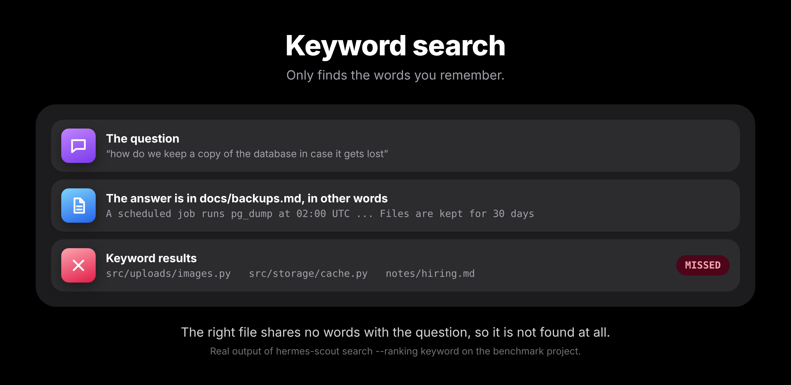
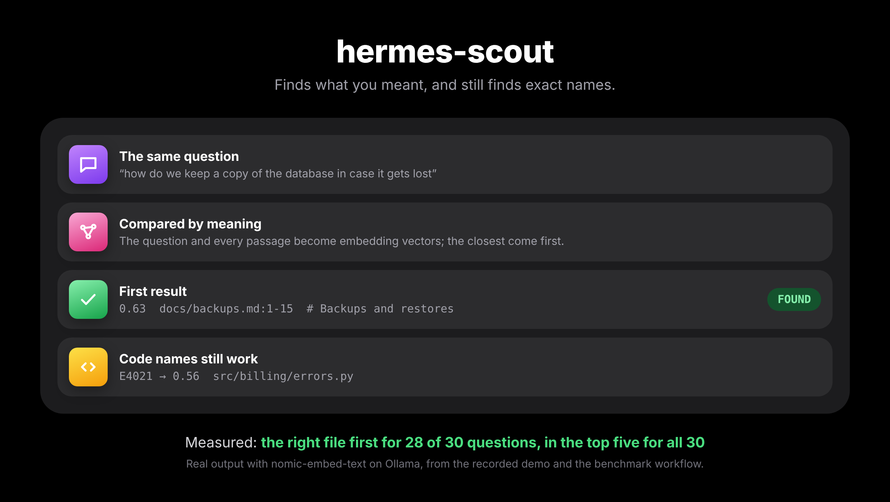
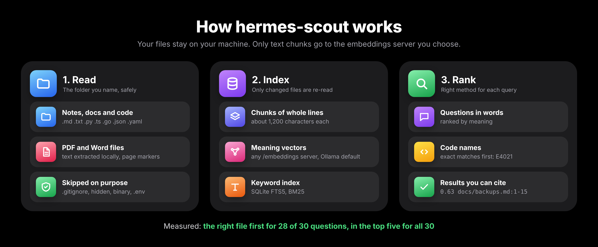
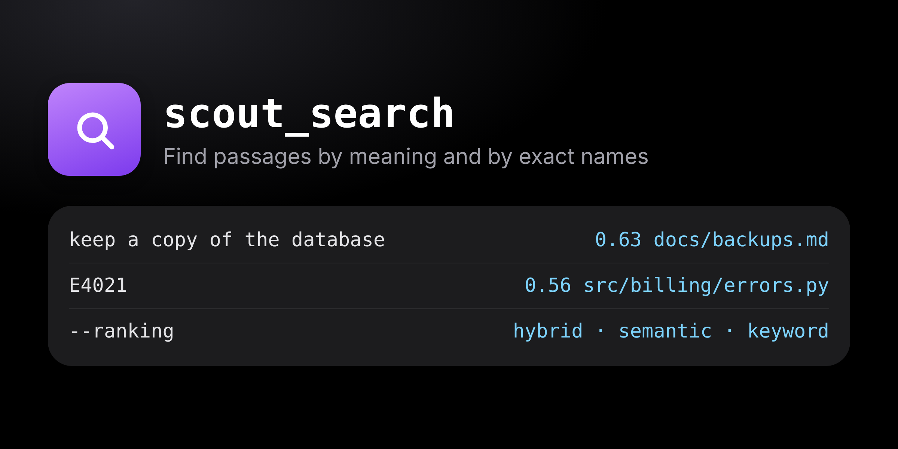
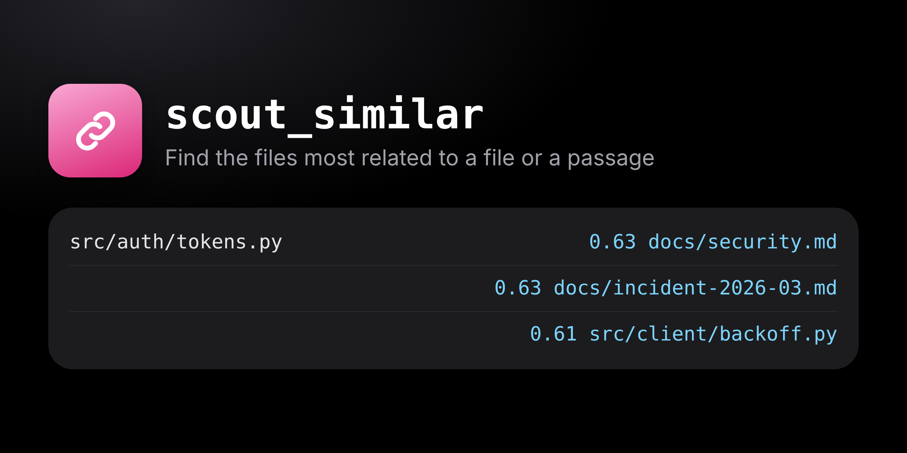
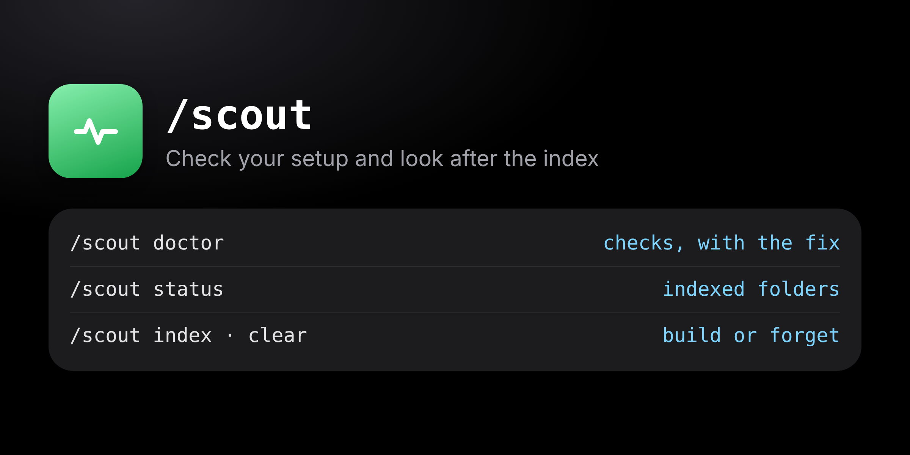
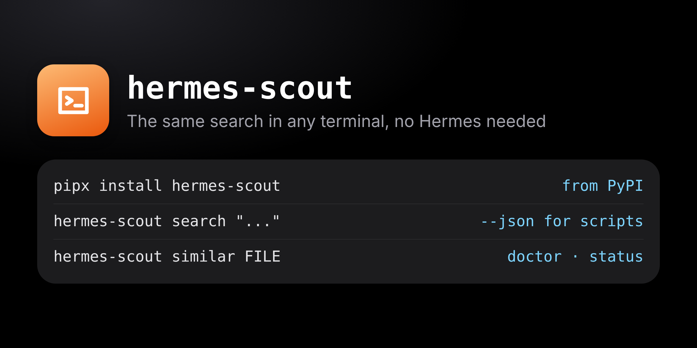

---
hide:
  - navigation
  - toc
---

<div class="scout-hero" markdown>


# Search your files by meaning

**hermes-scout** finds the passage you mean in your notes, docs, code, PDFs and Word files, even
when it never uses your words. A [Hermes Agent](https://github.com/NousResearch/hermes-agent)
plugin and a standalone command, running on your own machine.

[Get started](getting-started.md){ .md-button .md-button--primary }
[View on GitHub](https://github.com/Shizoqua/hermes-scout){ .md-button }

</div>

<video class="scout-demo" src="story.mp4" poster="story-poster.png" autoplay loop muted playsinline controls></video>

<p class="scout-caption">Every result and score in this video is real hermes-scout output on the synthetic
benchmark project, with <code>nomic-embed-text</code> on Ollama.</p>

## Keyword search misses what you meant





## Measured, not claimed

<div class="scout-stats" markdown>
<div class="grid cards" markdown>

- :material-target: **93%** of benchmark questions get the right file **first**
- :material-format-list-numbered: **100%** have it in the **top five**
- :material-swap-horizontal: **89%** first place on questions **worded differently** from the answer, against 39% for keywords alone

</div>
</div>

Thirty questions over a synthetic project, run against a real model on every change to the ranking
code. [Method and full results](benchmark.md).

## How it works



## What's inside

<div class="scout-inside" markdown>

[](hermes.md)

[](hermes.md)

[](hermes.md)

[](cli.md)

</div>

## In a terminal

<video class="scout-demo" src="demo.mp4" autoplay loop muted playsinline></video>

<p class="scout-caption">A real recorded session; the raw recording is in the repository as <code>docs/demo.cast</code>.</p>

## Why people use it

<div class="grid cards" markdown>

- :material-file-document-multiple: **PDF and Word files** are searched too, with page numbers in the results.
- :material-shield-lock: **Local-first and private**: works with Ollama, LM Studio, llama.cpp or vLLM; nothing is uploaded.
- :material-lightning-bolt: **Fast repeat searches**: an incremental index re-reads only files that changed.
- :material-code-braces: **Code names found first**: `ERR_4291`, `pg_dump` and `getUserById` match exactly.
- :material-source-branch: **Respects `.gitignore`** and filters like `*.md` or `docs/`.
- :material-stethoscope: **`/scout doctor`** checks your setup and names the fix in plain words.
- :material-package-variant-closed: **Zero dependencies**: Python standard library only.
- :material-test-tube: **Tested and fuzzed** on Linux, macOS and Windows, Python 3.11 to 3.14.

</div>

## Install

=== "Hermes plugin"

    ```bash
    hermes plugins install Shizoqua/hermes-scout
    hermes plugins enable hermes-scout
    ```

    Then ask Hermes: *"Search ~/notes for my backup plan."*

=== "Command line"

    ```bash
    pipx install hermes-scout
    hermes-scout search "how do we keep a copy of the database" ~/project
    ```

Both need an embeddings server; the easiest is [Ollama](https://ollama.com):
`ollama pull nomic-embed-text`. Full steps in [Getting started](getting-started.md).
