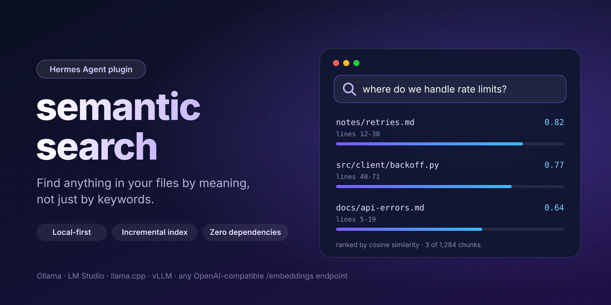
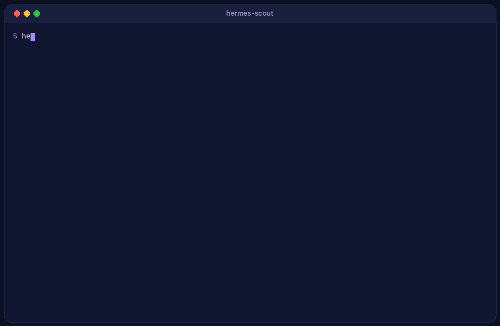

# hermes-scout

**Find passages in your local files by meaning, not just exact words.** Ask *"where do we handle rate
limits?"* and get back the relevant paragraphs from your notes, docs or code, even when they never use
the words "rate limit".

hermes-scout works two ways:

- **As a [Hermes Agent](https://github.com/NousResearch/hermes-agent) plugin**, adding a `scout_search`
  tool the agent can call.
- **As a standalone command**, `hermes-scout search "..." ~/notes`, for anyone with Python.

Embeddings come from any OpenAI-compatible `/embeddings` endpoint. By default that is a local
[Ollama](https://ollama.com) server, so your files never leave your machine.

- **Local-first**: works with Ollama, LM Studio, llama.cpp or vLLM on your own machine.
- **Fast repeat searches**: an incremental index only re-embeds files that changed.
- **Safe by default**: skips hidden files, dependency folders, binaries and credential files.
- **Respects `.gitignore`**, and searches can be narrowed with filters like `*.md` or `docs/`.
- **Zero dependencies**: Python standard library only.

[Get started](getting-started.md){ .md-button .md-button--primary }
[View on GitHub](https://github.com/Shizoqua/hermes-scout){ .md-button }
